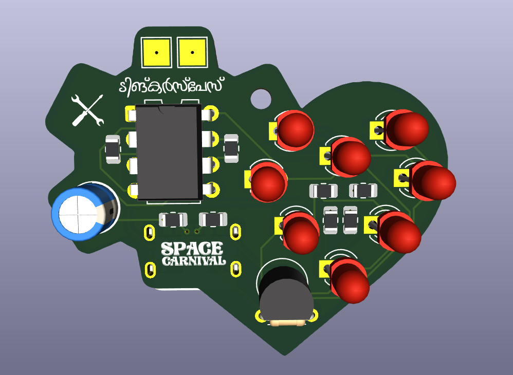
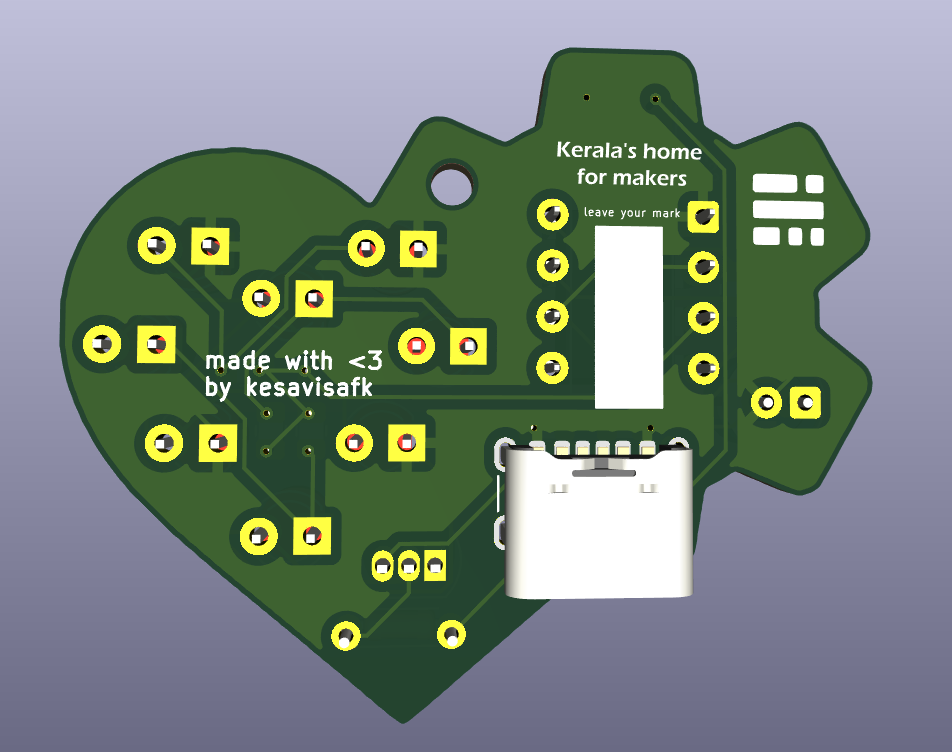
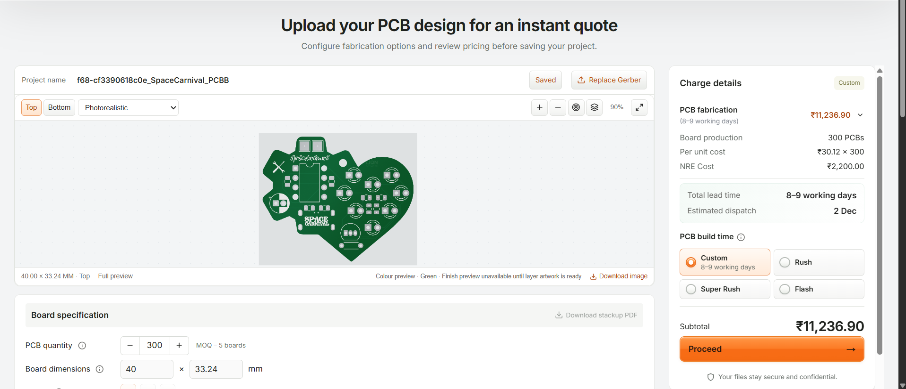
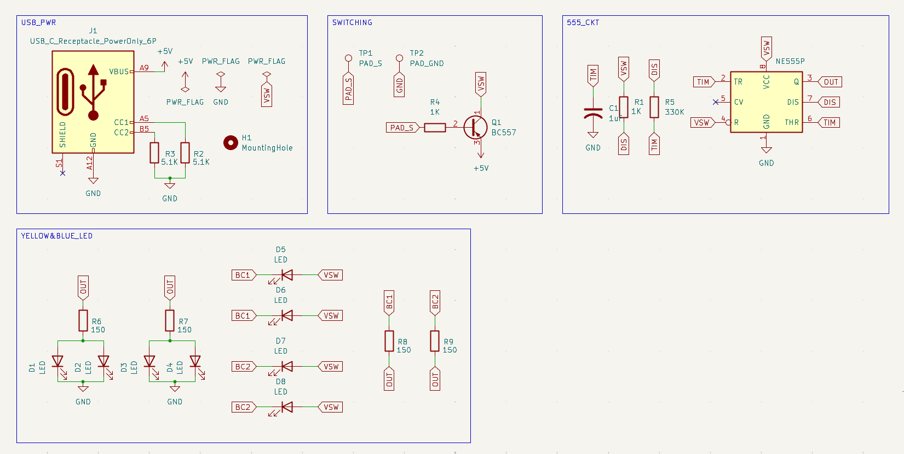
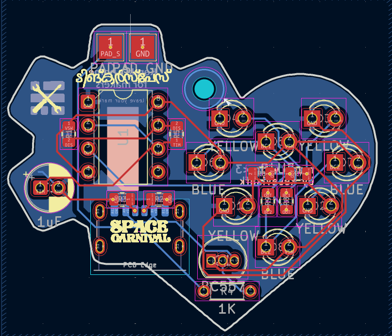
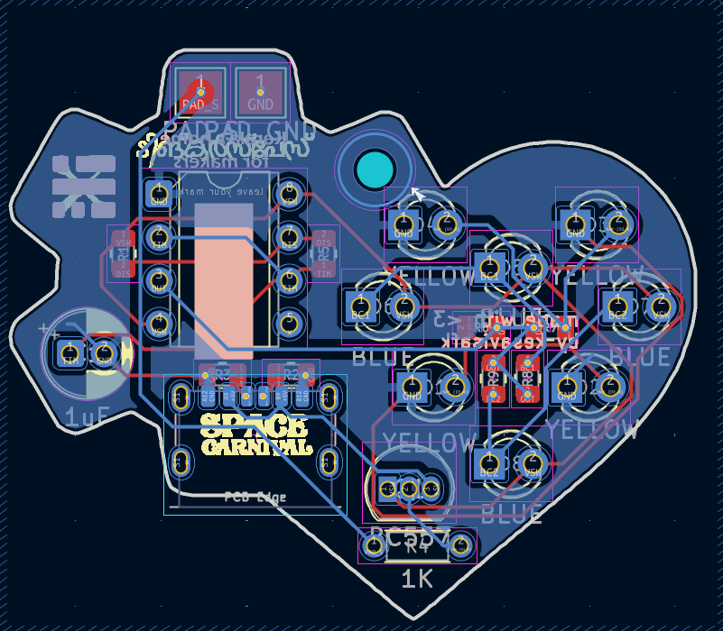

# TinkerSpace PCB Badge 2026 — Space Carnival Competition Entry

A PCB badge design submitted as an entry for the **Space Carnival 2026 PCB Badge Competition**. This repository contains the fabrication files for the badge, along with space to document the design and its development.


## Design

The physical layout of the badge combines a heart with a gear, representing my love for maker culture — the passion for creating, experimenting, building things, and learning by making. The design brings together the heart behind creativity and the mechanical side of making, with TinkerSpace's signature blue and yellow as its primary colours.

The circuit uses a 555 timer, a timing capacitor, resistors, and LEDs to create a flashing pattern of alternating yellow and blue lights. The board is powered by 5V through a USB-C connector.

But the main idea behind the badge goes beyond simply lighting up. I wanted the badge to encourage interaction and collaboration, making the PCB itself a part of the experience. Exposed contact pads on the top of the board allow two badges to be brought together and touched against each other. The LEDs only light up when two boards make contact, turning a standalone badge into something that comes alive through interaction.

The idea is to make the badge more than something you wear — it's something you can connect with someone else, quite literally. A small reminder that maker culture is built around sharing ideas, collaborating, and creating things together.

### Preview


| Front view | Back view |
| --- | --- |
|  |  |

*The LEDs appear red in the preview images. The actual badge will use alternating yellow and blue LEDs, switching between each other as the circuit cycles between HIGH and LOW states.*


## Bill of materials

The complete component list is also available in [`Tinkerspace PCB BOM.csv`](gerbers/Tinkerspace PCB BOM.csv). The table below summarises the parts used on one badge. Prices are indicative unit estimates based on bulk sourcing at approximately 300 pieces; actual supplier quotations may vary and may exclude GST, shipping, and minimum-order charges.


| Designator | Qty. per badge | Component | Package / value | Unit price (INR) | Line total (INR) | Source |
| --- | ---: | --- | --- | ---: | ---: | --- |
| R1 | 1 | SMD resistor | 0805, 1 kΩ | ₹0.06 | ₹0.06 | [Adinath – SMD chip resistors](https://www.adinathelectronics.com/chip-resistors.html) |
| R5 | 1 | SMD resistor | 0805, 330 kΩ | ₹0.06 | ₹0.06 | [Adinath – SMD chip resistors](https://www.adinathelectronics.com/chip-resistors.html) |
| R8, R6, R9, R7 | 4 | SMD resistors | 0805, 150 Ω | ₹0.06 | ₹0.24 | [Adinath – SMD chip resistors](https://www.adinathelectronics.com/chip-resistors.html) |
| R3, R2 | 2 | SMD resistors | 0805, 5.1 kΩ | ₹0.06 | ₹0.12 | [Adinath – SMD chip resistors](https://www.adinathelectronics.com/chip-resistors.html) |
| R4 | 1 | Axial resistor | 1 kΩ, 1/4 W | ₹1.00 (bulk cost used for 300 pcs) | ₹1.00 | [Electronic Spices – 1 kΩ axial resistor](https://electronicspices.com/product-category/all-electronics-components/resistors/1-4-watts-resistors/page/1) |
| D1–D4 | 4 | Yellow LEDs | 3 mm through-hole | ₹0.40 | ₹1.60 | [Adinath – through-hole LEDs](https://www.adinathelectronics.com/led-display.html) |
| D5–D8 | 4 | Blue LEDs | 3 mm through-hole | ₹0.40 | ₹1.60 | [Adinath – through-hole LEDs](https://www.adinathelectronics.com/led-display.html) |
| U1 | 1 | NE555P timer IC | DIP-8 | ₹5.07 | ₹5.07 | [Electronic Spices – NE555P, pack of 50](https://electronicspices.com/product/ne555p-precision-timer-dip-8-pins-ic-chip-pack-of-50pcs) |
| Q1 | 1 | BC557 PNP transistor | TO-92 | ₹2.24 | ₹2.24 | [Sunrom – BC557](https://www.sunrom.com/p/bc557) |
| C1 | 1 | Radial capacitor | 1 µF | ₹1.00 (bulk cost used for 300 pcs) | ₹1.00 | [Electronic Spices – capacitor supplier](https://electronicspices.com/) |
| J1 | 1 | USB-C receptacle | 6-pin SMD | ₹4.08 (300–499 qty tier) | ₹4.08 | [KTRON – 6-pin USB Type-C SMD](https://www.ktron.in/product/6-pin-usb-type-c-connector-smd/) |
| TP1, TP2 | 2 | Contact pads | PCB copper pads | Included in PCB | — | PCB copper layout |

### PCB fabrication (300 boards)

- PCB fabrication unit price: ₹30.12 per board
- Quantity: 300 boards
- NRE charge excluded



### Cost per badge

| Cost item | Per-badge cost |
| --- | ---: |
| Electronic components subtotal | ₹17.07 |
| PCB fabrication (300 boards, ₹30.12 each; NRE excluded) | ₹30.12 |
| **Total per badge** | **₹47.19** |

The resistor and capacitor are listed at ₹1 each as the bulk cost used for a 300-piece run; these are budgeting prices, not separately confirmed supplier quantity quotes. KTRON lists the USB-C receptacle at ₹4.08 each in the 300–499 quantity tier. Component subtotal excludes assembly, shipping, and taxes not already included in supplier prices.


## Schematic



## Fabrication files

The `SpaceCarnival_PCBBadge` folder contains the Gerber and drill files exported for PCB fabrication.

| File | Layer / purpose |
| --- | --- |
| `Tinkerspace PCB-F_Cu.gbr` | Front copper |
| `Tinkerspace PCB-B_Cu.gbr` | Back copper |
| `Tinkerspace PCB-F_Mask.gbr` | Front solder mask |
| `Tinkerspace PCB-B_Mask.gbr` | Back solder mask |
| `Tinkerspace PCB-F_Silkscreen.gbr` | Front silkscreen |
| `Tinkerspace PCB-B_Silkscreen.gbr` | Back silkscreen |
| `Tinkerspace PCB-F_Paste.gbr` | Front paste |
| `Tinkerspace PCB-B_Paste.gbr` | Back paste |
| `Tinkerspace PCB-Edge_Cuts.gbr` | Board outline |
| `Tinkerspace PCB-PTH.drl` | Plated through-hole drill data |
| `Tinkerspace PCB-NPTH.drl` | Non-plated through-hole drill data |
| `Tinkerspace PCB-job.gbrjob` | Gerber job file |

## PCB layout


| Front layout | Back layout |
| --- | --- |
|  |  |


## Design files

The files in this repository are laid out like this:

```
SpaceCarnival_PCBBadge/
├── README.md
├── LICENSE
├── gerbers/
│   ├── SpaceCarnival_PCBBadge.zip        # Gerber and drill files, upload this to your PCB fab
│   ├── Tinkerspace PCB BOM.csv           # bill of materials
│   └── Tinkerspace PCB.pdf               # printable schematic
└── docs/
    └── images/                       # preview, layout and schematic pictures used in this README
```

The Gerber zip holds the copper, solder mask, silkscreen, paste, board outline and drill files exported from KiCad.


## Submission notes

This project is a competition entry for Space Carnival 2026. The files and images in this repository are intended to present the badge design and provide the PCB fabrication data for review. Made for the TinkerSpace community in Kochi, designed by kesavisafk.

## License

The design files and documentation in this repository are released under the MIT License, see [`LICENSE`](LICENSE). The TinkerSpace and Space Carnival names and logos belong to their respective owners and are not covered by it.
